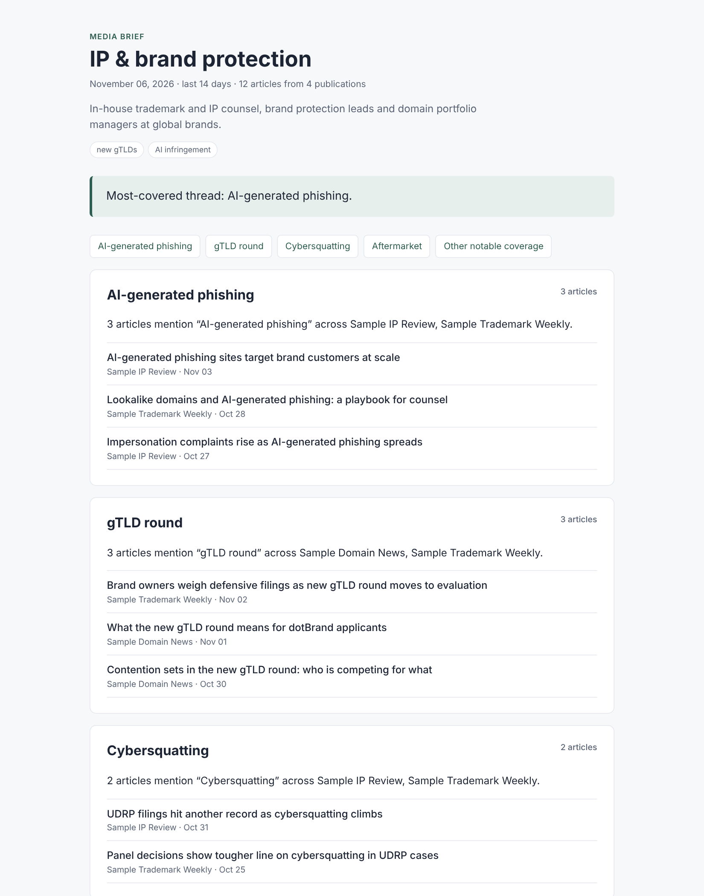

# media-pulse

**Tell it who your audience is. It reads the publications they read and hands back a themed brief with links.**


**Live briefs:** https://justfranklin.github.io/media-pulse/ (refreshed every Monday)


*Sample brief built from the demo data in `tests/fixtures`, using offline grouping.*

---

## The problem

In B2B marketing, the content that works is the content that matches what your buyers are already reading about. Finding it usually means someone opens a dozen trade publications every week, skims, and tries to spot the patterns. That takes hours, and most of it goes undone when things get busy.

Niche audiences make it harder. In-house trademark counsel, security leaders and marketing ops teams each read a small set of trade outlets. General social listening tools miss them, and that's where the useful signal is.

## What it does

1. **Starts from the audience.** Pick a preset or describe the audience in plain words ("in-house trademark counsel at global brands") and it matches the closest preset.
2. **Pulls recent coverage** from that audience's core publications, using RSS where a feed exists and a domain-restricted Google News search where it doesn't (or where the feed fails).
3. **Ranks for relevance** using the audience's keywords plus any focus topics you add, and drops anything outside the time window.
4. **Groups the coverage into themes.** With an Anthropic API key, Claude writes each theme, explains why it matters to this audience, and suggests content angles. Without a key, it falls back to offline keyword grouping, so it always produces a brief.
5. **Publishes the brief** as Markdown (archived in `/briefs`) and as a clean HTML page on GitHub Pages, every week, without anyone touching it.

## How I'd use it

- **Content planning:** turn the weekly themes into blog topics, LinkedIn posts and webinar agendas that line up with what the audience is already reading.
- **Sales enablement:** a one-page "what our buyers are reading" brief that reps can use to open conversations.
- **Event and webinar prep:** set focus topics such as `--topics "new gTLDs, AI infringement"` to research what a session should cover.
- **Search and AEO:** spot the questions and terms showing up in trade coverage before they appear in keyword tools.

## Quick start

```bash
git clone https://github.com/justfranklin/media-pulse.git
cd media-pulse
pip install -r requirements.txt

# See the audience presets and their publications
python -m mediapulse --list

# Describe an audience in your own words
python -m mediapulse --audience "in-house trademark counsel" --topics "new gTLDs, AI infringement" --days 14

# Or name presets directly (several at once builds an index page)
python -m mediapulse --preset ip-brand-protection,search-aeo --days 7

# Try it offline on demo data
python -m mediapulse --preset ip-brand-protection --fixture tests/fixtures/sample_articles.json --no-claude
```

For AI-written themes, set `ANTHROPIC_API_KEY` in your environment. The model defaults to `claude-sonnet-5-5`; override it with `MEDIA_PULSE_MODEL`.

Output goes to `briefs/` (Markdown) and `site/` (HTML).

## Add your own audience

Presets live in [`config/audiences.yaml`](config/audiences.yaml). Each one is a description, a keyword list and the publications that audience reads:

```yaml
retail-ecommerce:
  label: Retail & ecommerce
  description: Ecommerce and digital leads at mid-size retailers.
  keywords: [ecommerce, retail media, checkout, Shopify, loyalty, returns]
  sources:
    - {name: Modern Retail, domain: modernretail.co}
    - {name: Retail Dive, domain: retaildive.com}
```

`feed` is optional. Without it, media-pulse searches Google News for that domain.

## Automation

[`weekly-brief.yml`](.github/workflows/weekly-brief.yml) runs every Monday. It builds the briefs, commits the Markdown to `/briefs` and publishes the HTML to GitHub Pages. You can also run it on demand from the Actions tab with different presets or a different time window.

To turn it on:
1. **Settings → Pages →** set the source to **GitHub Actions**.
2. Optional: **Settings → Secrets and variables → Actions →** add `ANTHROPIC_API_KEY`.

## How it's built

```
mediapulse/
  sources.py   audience presets and free-text audience matching
  fetch.py     RSS + Google News fetch, cleanup, de-duplication
  rank.py      date window and keyword relevance
  themes.py    Claude theme extraction, offline keyword fallback
  render.py    Markdown + HTML output (Jinja templates)
  cli.py       command line
```

Some design choices:
- **Always produces something.** If a feed breaks, it falls back to Google News. If Claude is unavailable or returns something unusable, it falls back to keyword grouping.
- **Claude only sees headlines and short summaries** and has to cite article IDs. Every link in the brief comes from the fetched data, never from the model.
- **Tested without the network.** The tests use saved sample articles and a stand-in for the Claude client.

## Limits

- Google News results link through Google redirect URLs, and some publications are paywalled.
- Relevance ranking is keyword-based. It's simple and easy to inspect, but it doesn't understand meaning.
- Briefs reflect headlines and summaries, not full articles. Read the sources before quoting them.

## License

MIT
